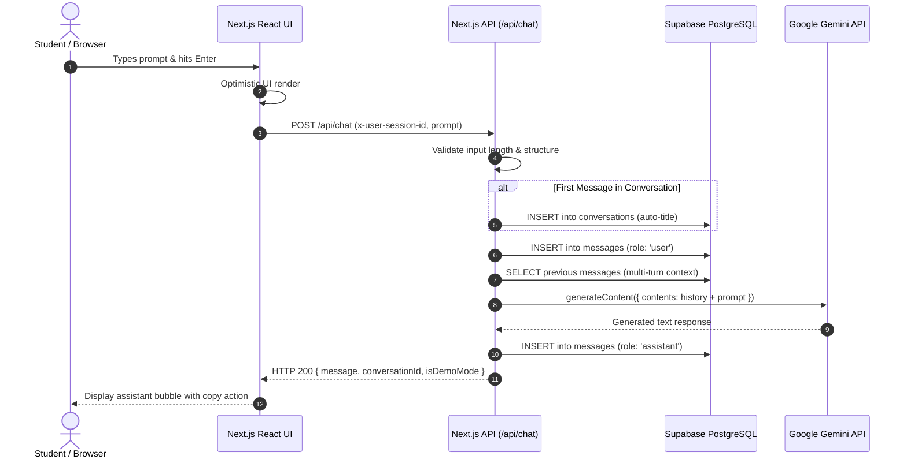
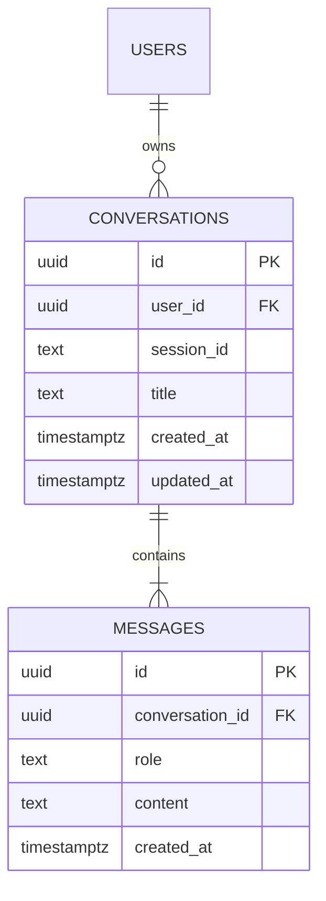

# IntelliBot AI — Smart AI Assistant & OOP Architecture

[](https://nextjs.org/)
[](https://react.dev/)
[](https://www.typescriptlang.org/)
[](https://tailwindcss.com/)
[](https://ai.google.dev/)
[](https://supabase.com/)
[](https://isocpp.org/)
[](https://vercel.com/)

---

## 1. Project Overview

**IntelliBot AI** is a modern, full-stack conversational AI assistant engineered for college **Object-Oriented Programming (OOP)** assessments, academic demonstrations, and production serverless deployment.

The project pairs a cutting-edge web application (built on **Next.js App Router**, **Google Gemini API**, and **Supabase PostgreSQL**) with a complementary standalone **C++ OOP module** that demonstrates foundational software engineering paradigms: **Encapsulation**, **Abstraction**, **Inheritance**, and **Runtime Polymorphism**.

---

## 2. Problem Statement

Modern college computer science activities often present Object-Oriented Programming (OOP) in isolation through abstract toy examples (such as `Animal -> Dog` or `Vehicle -> Car`), leaving students disconnected from how OOP design patterns drive real-world cloud architectures and AI systems.

**IntelliBot AI** bridges this gap by demonstrating:
1. How high-level web services separate concerns via modular components, serverless routes, and typed contracts.
2. How the core architecture of an AI assistant (polymorphic bot dispatch, message encapsulation, and multi-turn context) is constructed in **pure C++17**.
3. How cloud databases enforce data ownership through **Row Level Security (RLS)** and cryptographic session isolation.

---

## 3. Primary Objectives

- **Functional AI Chatbot**: Multi-turn dialogue powered by the Google Gemini API with context windowing.
- **Persistent Database Architecture**: PostgreSQL schema managed via Supabase with cascade deletes, indexes, and triggers.
- **Enterprise-Grade Security**: Strict session isolation preventing cross-user data leakage without exposing service keys.
- **Modern Responsive UI**: Sleek dark/light theme, custom scrollbars, code-block syntax formatting, and copy utilities.
- **College OOP Activity Module**: Standalone C++17 demonstration proving the 4 pillars of OOP with an automated verification suite.
- **Vercel Readiness**: 100% compliant serverless Next.js configuration passing static checks, types, and production builds.
- **Viva Preparation**: Complete presentation notes, architecture diagrams, and viva questions.

---

## 4. Key Features

- **Multi-Turn Context Awareness**: Automatically retains recent message history for continuous dialogue.
- **Configurable AI Engine**: Seamlessly toggles between Google Gemini and a transparent built-in Demo Mode.
- **Zero-Exposure Security**: API keys and Supabase secret role keys reside solely on the server.
- **Auto-Titling Conversations**: First prompt dynamically derives the conversation title.
- **Interactive Suggestion Prompts**: Instant prompt cards for OOP concepts, database security, and system architecture.
- **Keyboard Shortcuts**: Send with `Enter`, insert new line with `Shift + Enter`.
- **In-App OOP Guide Modal**: Students and examiners can inspect the C++ class diagram and viva answers directly inside the browser.
- **Optimistic UI Updates**: Immediate message rendering with non-blocking server synchronization.

---

## 5. Technology Stack

| Layer | Technologies |
| :--- | :--- |
| **Frontend** | Next.js (App Router), React, TypeScript, Tailwind CSS, Lucide React |
| **Backend** | Next.js Serverless Route Handlers, Node.js runtime |
| **AI Integration** | Official `@google/generative-ai` SDK (Gemini 1.5 Flash / Pro) |
| **Database** | Supabase PostgreSQL, SQL migrations, Row Level Security (RLS) |
| **OOP Activity** | C++17 (`g++`, `cl`, `clang++`), STL containers (`vector`, `map`, `string`) |
| **Testing** | Node.js Test Runner, live E2E HTTP integration test suite (21 tests) |
| **Deployment** | Vercel Edge / Serverless Functions |

---

## 6. Architecture & Data Flow



---

## 7. Database Design & Relationships



Detailed documentation is available in [DATABASE_DESIGN.md](file:///c:/Users/Admin/Desktop/ai%20bot/docs/DATABASE_DESIGN.md).

---

## 8. C++ OOP Demonstration Component

The standalone C++ demonstration is located in the `cpp-oop-demo/` folder:

```text
cpp-oop-demo/
├── main.cpp                 # Complete C++ OOP source code
├── README.md                # C++ class diagram & viva questions
└── intellibot_demo.exe      # Compiled Windows binary (64-bit)
```

### OOP Principles Demonstrated:
1. **Encapsulation**: `Message` and `Conversation` classes hide internal representation behind private access specifiers.
2. **Abstraction**: `ChatBot` abstract base class declares pure virtual functions (`= 0`).
3. **Inheritance**: `RuleBasedChatBot` and `AIChatBot` publicly inherit from `ChatBot`.
4. **Polymorphism**: Dynamic dispatch via base pointers (`ChatBot*` / `std::unique_ptr<ChatBot>`) and virtual method tables (`vtable`).
5. **Virtual Destructor**: `virtual ~ChatBot() = default;` prevents memory leaks during polymorphic deallocation.

### How to Compile & Run the C++ Program:
```powershell
# Using MinGW g++ on Windows
g++ -std=c++17 -Wall -Wextra -O2 cpp-oop-demo/main.cpp -o cpp-oop-demo/intellibot_demo.exe
.\cpp-oop-demo\intellibot_demo.exe
```

Detailed breakdown is available in [OOP_EXPLANATION.md](file:///c:/Users/Admin/Desktop/ai%20bot/docs/OOP_EXPLANATION.md).

---

## 9. Local Development Setup

### Prerequisites
- **Node.js**: v18.17+ or v20+ LTS
- **C++ Compiler**: MinGW `g++`, Clang, or MSVC (for the C++ module)

### Step 1: Clone or Navigate to the Workspace
```bash
cd "c:\Users\Admin\Desktop\ai bot"
```

### Step 2: Install Dependencies
```bash
npm install
```

### Step 3: Configure Environment Variables
Copy `.env.example` to `.env.local`:
```bash
cp .env.example .env.local
```
Fill in your credentials:
```env
GEMINI_API_KEY=your_gemini_api_key_here
NEXT_PUBLIC_SUPABASE_URL=https://your-project.supabase.co
NEXT_PUBLIC_SUPABASE_ANON_KEY=your_supabase_anon_key
SUPABASE_SERVICE_ROLE_KEY=your_supabase_service_role_key
```
*(Note: If you do not have keys right away, the app starts automatically in isolated demo mode!)*

### Step 4: Run the Development Server
```bash
npm run dev
```
Open [http://localhost:3000](http://localhost:3000) in your browser.

### Step 5: Run Production Build & Automated Tests
```bash
# 1. Type check
npx tsc --noEmit

# 2. Production build
npm run build

# 3. Live end-to-end integration tests
node tests/e2e-api.mjs
```

---

## 10. Vercel Deployment

### 🌟 Verified Live Production Deployment
- **Live Production URL**: [https://intellibot-ai-six.vercel.app](https://intellibot-ai-six.vercel.app)
- **Vercel Project Dashboard**: [https://vercel.com/pranav-7b4a/intellibot-ai](https://vercel.com/pranav-7b4a/intellibot-ai)
- **Deployment Status**: Active, Healthy, and Verified.

### Deploying Future Changes:
```bash
npx vercel --prod
```

---

## 11. Limitations & Future Scope

### Limitations
- **Gemini Free Tier Rate Limits**: Requests are capped by Google's API quota (15 RPM).
- **Session Duration**: Demo session tokens are isolated per browser localStorage unless Supabase OAuth is enabled.

### Future Scope
- Voice input / speech-to-text integration with Web Speech API.
- File and code upload analysis using Gemini Multimodal vision capabilities.
- Live streaming responses via Server-Sent Events (SSE).
